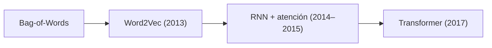
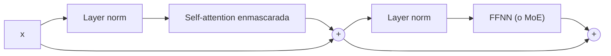

# How Transformer LLMs Work: notas

Fuente: [How Transformer LLMs Work (DeepLearning.AI)](https://learn.deeplearning.ai/courses/how-transformer-llms-work), de Jay Alammar y Maarten Grootendorst. Terminado el 04/11/2026.

Complementa las [notas de *The Illustrated Transformer*](illustrated-transformer.md). Cuando un tema ya está explicado ahí, lo indico con "(IT §N)".

## 1. Las tres familias de modelos

| Familia | Qué hace | Atención | Ejemplos |
|---|---|---|---|
| *Encoder-only* (solo codificador) | Crea una representación **sensible al contexto** de la entrada. No genera texto. | Bidireccional: cada token ve a todos | BERT (2018) → DistilBERT (2019) → RoBERTa (2019). También la mayoría de los modelos de *embeddings* |
| *Decoder-only* (solo decodificador) | **Genera** texto, un token por vez | Enmascarada: cada token ve solo a los anteriores | GPT (2018) → GPT-2 (2019) → GPT-3 (2020) → ChatGPT (2022). Los LLM de OpenAI, Anthropic, Cohere y Meta |
| *Encoder-decoder* (codificador-decodificador) | Transforma una secuencia en otra, como en una traducción | Las dos, más la atención codificador-decodificador | T5 (2019) → Switch Transformer (2021) → Flan-T5 (2022) |

Antes del Transformer:



Corrección: la atención no aparece en 2017. Se agregó a las RNN en 2014–2015, y lo nuevo en 2017 es **quedarse solo con la atención** (IT §10).

## 2. Bag-of-Words

Divide el texto por espacios y **cuenta** cuántas veces aparece cada palabra del vocabulario.

```
Oraciones:     "that is a cute dog"   y   "my cat is cute"
Vocabulario:   that  is  a  cute  dog  my  cat

"my cat is cute" →  0    1   0   1    0   1   1     ← vector de 7 posiciones (1×7)
```

- El vector tiene tantas posiciones como palabras haya en el vocabulario, y casi todas valen 0.
- **No captura significado**: "cute" y "adorable" son dos posiciones distintas, sin relación entre sí. Tampoco captura el orden: "dog bites man" y "man bites dog" dan el mismo vector.
- Ojo con el nombre: es una **representación vectorial**, pero no un *embedding* en el sentido de los modelos. Un *embedding* es denso y se aprende en el entrenamiento.

## 3. Word2Vec y los *embeddings* estáticos

- Una red neuronal aprende *embeddings* que capturan **significado**. En el entrenamiento intenta predecir si dos palabras suelen aparecer **cerca** en un texto. Así, las palabras que aparecen en contextos parecidos terminan con vectores parecidos.
- Los *embeddings* son **estáticos**: "bank" tiene el mismo vector en "river bank" y en "bank account". El contexto no lo cambia.
- Lo que resuelve el Transformer es justamente eso: después de la atención, cada token tiene un vector **que depende del contexto**.

## 4. RNN: codificar y decodificar

Las RNN procesan una secuencia token por token (IT §2) y se usan para dos tareas:
- **Codificar**: representar la oración de entrada.
- **Decodificar**: **generar** la oración de salida.

La generación es **autorregresiva**: cada token generado se agrega a la entrada del paso siguiente. Este es el ejemplo de traducción al neerlandés:

```
        Entrada                        Salida
Paso 1  I love llamas                  Ik
Paso 2  I love llamas Ik               hou
Paso 3  I love llamas Ik hou           van
Paso 4  I love llamas Ik hou van       lama's
```

Sin atención, el codificador comprime toda la entrada en **un solo vector de contexto**, y eso es un cuello de botella. Con atención, el decodificador mira los *embeddings* de **todos** los tokens de la entrada en cada paso, y por eso la salida mejora tanto (IT §10).

## 5. *Attention Is All You Need*

| Bloque | Capas |
|---|---|
| Codificador | Self-attention → FFNN |
| Decodificador | Self-attention **enmascarada** → atención codificador-decodificador → FFNN |

(Cada capa va con su conexión residual y su normalización. Ver §9 y IT §1.)

### Pesos de atención

La self-attention compara cada token con todos los demás. Su resultado es una matriz de pesos **(n×n)**: la fila = el token que pregunta y la columna = el token al que mira. **Cada fila suma 1**, porque sale de un softmax. Esta es una matriz ilustrativa para "I love llamas" (3×3):

```
           I     love   llamas
I       [ 0,6    0,3    0,1  ]   = 1
love    [ 0,25   0,5    0,25 ]   = 1
llamas  [ 0,1    0,3    0,6  ]   = 1
```

Ojo: el ejemplo del curso tiene la fila de "love" en `[0,5 1 0,5]`, que suma 2. Sirve como ilustración de "cuánto se relacionan", o como puntajes **antes** del softmax, pero después del softmax cada fila tiene que sumar 1.

### Máscara del decodificador

Tapa el triángulo **de arriba de la diagonal**, sin incluir la diagonal, así que cada token ve los anteriores y a sí mismo. Con la misma oración:

```
           I     love   llamas
I       [ 1      0      0    ]   ← solo se ve a sí mismo
love    [ 0,33   0,67   0    ]   ← lo de la fila anterior, renormalizado: 0,25/0,75 y 0,5/0,75
llamas  [ 0,1    0,3    0,6  ]   ← el último ve todo: igual que sin máscara
```

Es el ejercicio `03-codificador/mascara.py`: se suma `-∞` antes del softmax, y `e^-∞ = 0` (IT §9).

## 6. BERT (*Bidirectional Encoder Representations from Transformers*)

- Es *encoder-only*. Al principio de la entrada agrega un token especial, **`[CLS]`**. Su vector de salida se usa como representación de la oración entera, por ejemplo para clasificarla.
- Se entrena en dos etapas:
  1. **Pre-entrenamiento** con *Masked Language Modeling*. Se tapan palabras al azar (alrededor del 15%) y el modelo tiene que predecirlas. Como ve el contexto de los dos lados, aprende representaciones bidireccionales. Se usa con muchísimo texto sin etiquetar.
  2. **Ajuste fino** (*fine-tuning*) para una tarea concreta, como clasificación, con pocos datos etiquetados.

Ojo: "máscara" significa cosas distintas en BERT y en GPT. En BERT se tapan **tokens de la entrada**. En GPT se tapan **posiciones futuras** en la matriz de atención.

## 7. Qué hace cada pieza

**La cabeza de lenguaje** (*LM head*) es la capa final. Convierte el vector del último token en *logits* sobre todo el vocabulario, y después un softmax da la probabilidad del token siguiente (IT §11).

**La FFNN y la atención tienen papeles distintos:**
- **FFNN**: guarda lo que el modelo "sabe" por el entrenamiento. Que "The Shawshank" sigue con "Redemption" se puede predecir **sin atención**, porque es un dato memorizado.
- **Atención**: aporta el **contexto**. Por ejemplo, la *coreference resolution*: decidir a qué se refiere "it" en "The animal didn't cross the street because it was too tired" depende de los otros tokens del prompt (IT §7).

**La self-attention tiene dos pasos:**

1. ***Relevance scoring*** (puntaje de relevancia). Las **matrices de proyección** `WQ`, `WK` y `WV` son las que se entrenan. Multiplicadas por los *embeddings* dan `Q = X·WQ`, `K = X·WK` y `V = X·WV`. El puntaje del token actual contra cada token anterior es el producto punto de **su vector `q`** con cada `k`: `q_actual · k_j / √d_k`. Después se aplica el softmax.
2. ***Combining information*** (combinar información). Suma los `v` ponderados por esos puntajes: `z = Σ peso_j · v_j`.

Corrección: en mi versión anterior decía "el producto, serán Q y WQ" y que el producto era "la matriz de proyección por los *Key*". `WQ` es la matriz que se aprende y `Q` es el resultado de multiplicarla por `X`. El puntaje se calcula con el **vector** `q`, no con la matriz. Es lo que hace `puntajes(Q, K)` en `02-numpy/atencion.py`.

## 8. Cómo se mejoró la atención

### *Multi-query* y *grouped-query attention*

En *multi-head* clásica, cada cabeza tiene su propio `WQ`, `WK` y `WV` (IT §7). Las variantes **comparten `K` y `V`**, y cada cabeza sigue teniendo su propio `Q`:

| Variante | Cabezas de `Q` | Juegos de `K`/`V` |
|---|---|---|
| *Multi-head* | 8 | 8 (uno por cabeza) |
| *Multi-query* | 8 | **1**, compartido por todas |
| *Grouped-query* | 8 | **2**: cada grupo de 4 cabezas comparte uno |

¿Para qué? Para la **inferencia**. Al generar, las `K` y `V` de los tokens anteriores se guardan en memoria (*KV cache*) para no recalcularlas. Si hay menos juegos de `K`/`V`, la cache ocupa menos y la generación es más rápida. La calidad baja poco, sobre todo con *grouped-query*.

Corrección: en mi primera versión decía "una sola matriz de proyección". Lo que se comparte es la de `K` y `V`, no la de `Q`.

### Atención dispersa (*sparse attention*)

La atención completa cuesta `n²`. La dispersa hace que cada token mire solo **algunos** tokens anteriores:

- **Global**: la autorregresiva normal, donde cada token ve a todos los anteriores.
- **Local**: solo los últimos *w* tokens, por ejemplo 4, 6 o 16.
- **Strided** (con salto): los últimos *w* tokens más uno de cada *w* hacia atrás. En la matriz se ven líneas paralelas a la diagonal.
- **Fixed** (por bloques): bloques fijos, que en la matriz se ven como triángulos sobre la diagonal.

```
Global (4 tokens)    Local, w = 2
| ■ · · · |          | ■ · · · |
| ■ ■ · · |          | ■ ■ · · |
| ■ ■ ■ · |          | · ■ ■ · |
| ■ ■ ■ ■ |          | · · ■ ■ |
```

Se suelen **alternar** capas de atención completa con capas de atención dispersa, como hace GPT-3. No todas las capas son dispersas.

***Ring attention***: para contextos larguísimos, reparte la secuencia en bloques entre varias GPU conectadas en anillo. Cada GPU le pasa sus bloques de `K` y `V` a la siguiente.

## 9. El bloque de un decodificador moderno



La diferencia con el paper original (IT §1) está en dónde va la normalización. Ahora va **antes** de cada capa (*pre-norm*), y la suma residual va después: `x + capa(norm(x))`. Así se entrenan modelos más profundos sin que se rompan. Muchos modelos, como Llama, usan además **RMSNorm**, una versión simplificada de *layer norm*.

## 10. *The Llama 3 Herd of Models*: Llama 3 8B

| | 8B | Qué significa |
|---|---|---|
| Capas | 32 | Bloques de decodificador apilados |
| Dimensión del modelo | 4.096 | `d_model` (512 en el paper original) |
| Dimensión de la FFN | 14.336 | 3,5 × `d_model` |
| Cabezas de atención | 32 | Cabezas de `Q`. `d_head = 4.096 / 32 = 128` (en el paper, 512 / 8 = 64) |
| Cabezas de *key/value* | 8 | *Grouped-query*: cada juego de `K`/`V` lo comparten 32 / 8 = 4 cabezas |
| Tamaño del vocabulario | 128.000 | El tamaño de los *logits* de la cabeza de lenguaje |
| *Peak learning rate* * | 3 × 10⁻⁴ | |
| Función de activación * | SwiGLU | |
| *Embeddings* posicionales * | RoPE (θ = 500.000) | |

\* Todavía no los entiendo. Te dejo una primera idea de cada uno, para verlos en detalle más adelante:

- ***Peak learning rate***: el *learning rate* indica cuánto se ajustan los pesos en cada paso del entrenamiento. No es fijo: sube durante el *warmup* hasta este **pico** y después baja de a poco. Lo vamos a ver en el módulo 5, cuando entrenemos.
- **SwiGLU**: una variante de la FFN. En lugar de `ReLU(x·W1)·W2` usa una "compuerta": `(swish(x·W1) ⊙ (x·W3))·W2`, donde `⊙` es la multiplicación elemento a elemento. Tiene tres matrices en vez de dos.
- **RoPE** (*rotary position embeddings*): **sí es** una codificación posicional, pero aplicada de otra forma. En vez de **sumar** un vector de posición al *embedding*, una sola vez y al principio (IT §8), **rota** `q` y `k` en cada capa, con un ángulo que depende de la posición. Así `q·k` depende de la **distancia** entre los dos tokens. θ es la base de esos ángulos: un θ más grande soporta contextos más largos.

Corrección: en mi primera versión decía "los modelos modernos no usan *positional encoding*, usan *rotary embeddings*". RoPE **es** una forma de codificación posicional. Lo que dejó de usarse es la versión **sumada** del paper original.

## 11. *Mixture of Experts* (MoE)

- En cada capa, la FFNN se reemplaza por **varios expertos** (`Expert 1`, `Expert 2`, …). Cada experto es una FFNN más chica.
- El **router** es una red chica: una capa lineal más un softmax. Para **cada token** asigna una probabilidad a cada experto, y se activan solo los *k* mejores, por ejemplo 2 de 8. La elección es **dinámica**: cambia token por token y capa por capa.
- Cada experto tiende a especializarse en algún tipo de token o de patrón, pero no en "temas" que un humano reconocería.

| Pros | Contras |
|---|---|
| Menos **cómputo** por token en la inferencia: solo trabajan *k* expertos | Mucha **VRAM**: hay que cargar todos los expertos, aunque se usen pocos |
| Más parámetros (capacidad) por el mismo costo de cómputo | Más riesgo de *overfitting* y entrenamiento más inestable |
| Arquitectura flexible | Arquitectura más compleja: hay que balancear la carga para que el router no use siempre los mismos expertos |

Corrección: en mi primera versión decía "*Low VRAM for inference*". Lo que baja en la inferencia es el **cómputo**. La memoria no baja, porque los expertos tienen que estar cargados igual.

## Pendiente

- [ ] Entender en detalle RoPE, SwiGLU y el *learning rate schedule* (ver `PROGRESO.md`).
- [ ] Implementar *pre-norm* en el módulo 3 y comparar con el orden del paper original.
