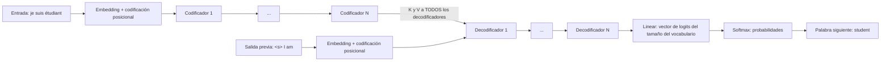
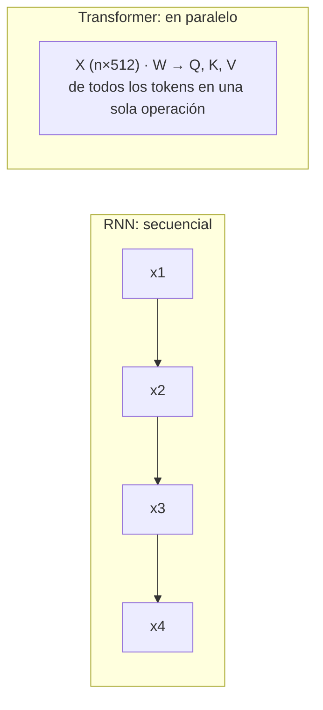
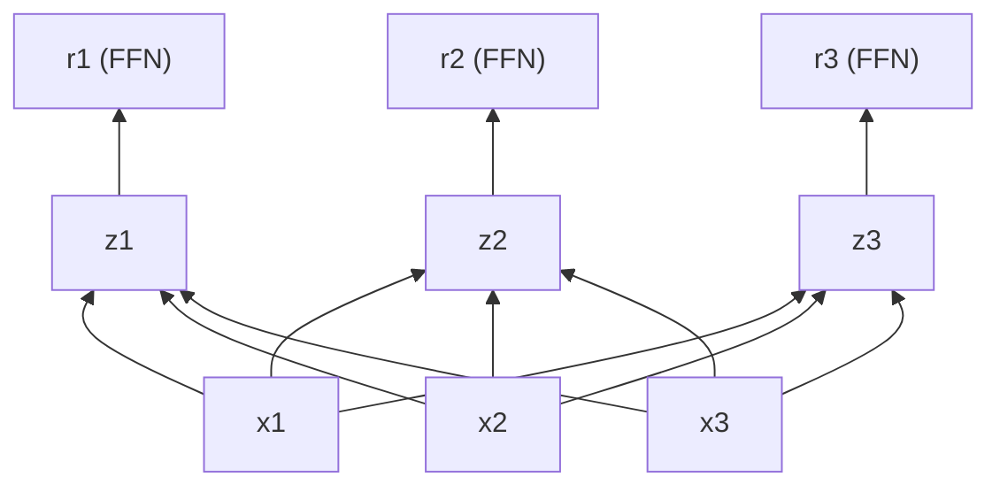
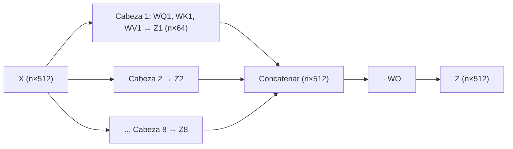

# The Illustrated Transformer: notas

Fuente: [The Illustrated Transformer (Jay Alammar)](https://jalammar.github.io/illustrated-transformer/). Leído el 29/10/2026.

Ver también: [notas del curso *How Transformer LLMs Work*](how-transformer-llms-work.md), que suma BERT, *grouped-query attention*, atención dispersa, Llama 3 y *Mixture of Experts*.

## 1. Arquitectura

- **Encoder = codificador** y **decoder = decodificador**. Las traducciones son correctas.
- El paper original apila 6 codificadores y 6 decodificadores. No es obligatorio que haya la misma cantidad de cada uno, pero lo usual es que sí.



Dentro de cada bloque:

| Codificador | Decodificador |
|---|---|
| Self-attention (ve **todos** los tokens) | Self-attention **enmascarada** (solo ve los anteriores) |
| Add & Normalize | Add & Normalize |
| — | Atención codificador-decodificador (Q del decodificador; K y V del codificador) |
| Feed-forward | Add & Normalize |
| Add & Normalize | Feed-forward → Add & Normalize |

Correcciones a tu esquema:
- El **embedding** y la codificación posicional se aplican **una sola vez**, antes del primer codificador. No van dentro de cada bloque.
- **Add & Normalize** es una conexión residual (`x + capa(x)`) seguida de una normalización de capa (*layer norm*).
- El decodificador recibe dos entradas: lo que ya generó y la salida (K, V) del último codificador.

## 2. ¿Cómo hace la atención para que el entrenamiento sea más rápido?

Tu idea es correcta: la atención mide cuánto se relaciona cada token con los demás. La velocidad viene de **lo que reemplaza**.

- En una **RNN** (*Recurrent Neural Network*), el estado de cada token depende del estado del anterior: `h3 = f(h2, x3)`. Así, para procesar la palabra 100 primero hay que haber procesado las 99 anteriores, una por una. Ese cálculo no se puede paralelizar.
- En el **Transformer**, la atención de todos los tokens se calcula **a la vez**, con una sola multiplicación de matrices (`Q·Kᵀ`). Las GPU y las TPU están hechas justamente para eso.



Además, en una RNN la información entre dos palabras lejanas tiene que pasar por todos los pasos intermedios, y se va diluyendo. Con atención, cualquier par de palabras está a un solo paso.

## 3. ¿Qué es una TPU?

Una **TPU** (*Tensor Processing Unit*) es un chip de Google diseñado para multiplicar matrices (tensores) muy rápido. "Cloud TPU" es el servicio de Google Cloud para alquilarlas. Cumple el mismo papel que una GPU.

## 4. ¿Vector y tensor son lo mismo?

Un tensor es la generalización de un vector a cualquier cantidad de dimensiones:

| Rango | Nombre | Ejemplo en el Transformer |
|---|---|---|
| 0 | escalar | `√64 = 8` |
| 1 | vector | el embedding de un token: `[512]` |
| 2 | matriz | `X` de una oración: `[n_tokens × 512]` |
| 3 | tensor | un lote (*batch*) de oraciones: `[batch × n_tokens × 512]` |

El artículo dice "vectors/tensors" porque los frameworks (TensorFlow, PyTorch) llaman tensor a todo. En la práctica se entrena por lotes, así que casi siempre se trabaja con tensores de rango 3.

## 5. ¿Qué son las "dependencias entre caminos"?

Cada token tiene su propio "camino" a través del codificador.

- **Self-attention:** para calcular `z1` hacen falta `x1, x2, …, xn`, es decir, **todos** los tokens. Esa es la dependencia. En el codificador no son solo los anteriores, también los posteriores: la atención es bidireccional.
- **Feed-forward:** `r1` depende **solo** de `z1`. Es la misma red aplicada a cada posición por separado, así que se pueden calcular las n posiciones en paralelo.



**¿Es esta la base de las cabezas de atención?** No. Son dos paralelismos distintos:
- **Entre posiciones:** cada token se procesa a la vez. Es lo que dice esta frase.
- **Entre cabezas:** el mismo token se mira con 8 juegos de matrices distintos. Lo vemos en la sección 7.

## 6. Self-attention paso a paso

`Q`, `K` y `V` salen de multiplicar el embedding por `WQ`, `WK` y `WV`. Esas matrices se aprenden en el entrenamiento. Repaso de tu ejemplo, con `(1×4)·(4×3) = (1×3)`:

```
x1 = [1 0 2 3]      WQ = | 1 0 1 |
                         | 0 2 1 |      q1 = x1·WQ = [3 5 7]
                         | 1 1 0 |
                         | 0 1 2 |
```

En el paper: `x` es `1×512`, `WQ` es `512×64` y `q` es `1×64`.

### Ejemplo con 2 tokens (`d_k = 4`, entonces `√d_k = 2`)

```
q1 = [1 0 1 0]   k1 = [1 1 1 0]   v1 = [1 0 0 2]
q2 = [0 1 0 1]   k2 = [2 0 2 1]   v2 = [0 2 2 0]
```

| Paso | Token 1 |
|---|---|
| 2. Puntaje `q1·kj` | `q1·k1 = 2`, `q1·k2 = 4` |
| 3. Dividir por `√d_k = 2` | `[1, 2]` |
| 4. Softmax | `[e¹, e²] / (e¹+e²) = [0,27  0,73]` |
| 5. Ponderar cada `v` | `0,27·v1 = [0,27 0 0 0,54]` y `0,73·v2 = [0 1,46 1,46 0]` |
| 6. Sumar | `z1 = [0,27  1,46  1,46  0,54]` |

Interpretación: el token 1 "presta atención" un 73% al token 2 y un 27% a sí mismo.

### La misma cuenta en forma matricial (como se calcula en realidad)

```
Z = softmax( Q·Kᵀ / √d_k ) · V

Q·Kᵀ = | 2 4 |   /2 →  | 1    2   |  softmax por fila →  | 0,27 0,73 |
       | 1 1 |         | 0,5  0,5 |                       | 0,5  0,5  |

Z = | 0,27 0,73 | · | 1 0 0 2 |  =  | 0,27 1,46 1,46 0,54 |   ← z1
    | 0,5  0,5  |   | 0 2 2 0 |     | 0,5  1    1    1    |   ← z2
```

Una sola operación calcula los `z` de todos los tokens. Este es el paralelismo de la sección 2.

**¿Por qué se divide por `√d_k`?** Porque el producto punto crece con la dimensión. Con valores grandes, el softmax da casi `[0, 1]` y los gradientes quedan casi en cero, así que la red aprende poco. Dividir mantiene los puntajes en una escala razonable.

## 7. Multi-head attention

### Corrección de dimensiones

El modelo tiene `d_model = 512`, no 64. El 64 es la dimensión **de cada cabeza**: 8 cabezas × 64 = 512.

```
X (n×512) · WQ_i (512×64) → Q_i (n×64)     para i = 1..8
Z_i = Attention(Q_i, K_i, V_i)  → n×64
Concat(Z_1..Z_8)               → n×512
Concat · WO (512×512)          → Z (n×512)   ← lo que espera la feed-forward
```



### ¿Da lo mismo que una sola cabeza de 512?

No, y tu intuición sobre la concatenación va bien encaminada:
- **Una cabeza** produce **un solo** softmax por token, o sea, un único promedio ponderado. Si "it" mira 90% a "animal", ya no le queda atención para "tired".
- **Ocho cabezas** producen **8 distribuciones independientes**. Una cabeza puede resolver a quién se refiere "it" ("animal") y otra qué le pasa ("tired"). `WO` combina después lo que encontró cada una.

Ejemplo: el token "it" con 2 cabezas sobre 3 tokens:

```
                animal  street  tired
Cabeza 1:     [  0,85    0,05    0,10 ]   ← resuelve la referencia
Cabeza 2:     [  0,10    0,05    0,85 ]   ← mira el estado
Una cabeza:   [  0,50    0,05    0,45 ]   ← un promedio que mezcla las dos cosas
```

### ¿Mejora el rendimiento?

La mejora es de **calidad** (expresividad), no de velocidad. Como cada cabeza trabaja en 64 dimensiones, el costo total de 8 cabezas es más o menos el de una cabeza de 512. Eso significa "make the computation of multiheaded attention (mostly) constant": hay más capacidad por el mismo costo.

## 8. Codificación posicional

La atención **no ve el orden**: si mezclás los tokens de la entrada, cada `z` sale igual, solo que en otro orden. Por eso, al embedding se le **suma** (no se concatena) un vector que depende de la posición, armado con senos y cosenos. Así, "el perro mordió al hombre" y "el hombre mordió al perro" dan representaciones distintas.

## 9. Decodificador y enmascaramiento

**¿El decodificador es donde no se atiende a los tokens posteriores?** Sí, pero solo en su **self-attention**.

| Capa | ¿Ve el futuro? |
|---|---|
| Self-attention del codificador | Sí, ve toda la entrada |
| Self-attention del decodificador | **No, está enmascarada** |
| Atención codificador-decodificador | Sí, ve toda la entrada |

La máscara pone `-∞` antes del softmax, y `e^-∞ = 0`. Con el ejemplo de la sección 6:

```
puntajes / 2 = | 1    2   |   máscara →  | 1    -∞  |   softmax →  | 1    0   |
               | 0,5  0,5 |              | 0,5  0,5 |              | 0,5  0,5 |
```

El token 1 ya no puede "espiar" al token 2.

Por qué importa:
- **En el entrenamiento** se conoce toda la traducción, así que se calculan todas las posiciones **en paralelo** y la máscara evita hacer trampa. Esto también suma a la velocidad de la sección 2.
- **En la inferencia** se genera un token por vez, y cada token generado se vuelve entrada del paso siguiente, hasta llegar a `<eos>`.

Tu idea de "cada token solo mira a los anteriores" es exactamente cómo funciona **GPT**. GPT es *decoder-only*: toda su atención está enmascarada. BERT, en cambio, es *encoder-only* y es bidireccional.

## 10. ¿Qué tiene que ver con los modelos seq2seq?

Los modelos **seq2seq** (2014) eran un codificador RNN y un decodificador RNN. El codificador comprimía toda la oración en **un solo vector**, y eso era un cuello de botella en oraciones largas. En 2015 se agregó la **atención**: en cada paso, el decodificador mira todos los estados del codificador y elige en cuáles enfocarse.

La capa **codificador-decodificador** del Transformer es esa misma idea: `Q` sale del decodificador ("qué estoy buscando") y `K` y `V` salen del codificador ("qué hay en la entrada"). Lo que cambia es que el Transformer eliminó las RNN y se quedó **solo con la atención**, de ahí el título del paper: *Attention Is All You Need*.

## 11. Salida (Linear + Softmax)

Tu resumen es correcto. Una precisión: lo que resulta del entrenamiento son los **pesos** (`WQ`, `WK`, `WV`, `WO`, la FFN y la capa Linear). Las probabilidades se **calculan** en cada paso a partir de la entrada y de esos pesos.

```
vector del decodificador (512) · W_linear (512 × 10.000) → logits (10.000) → softmax → p("student") = 0,92
```

Elegir siempre la de mayor probabilidad se llama *greedy decoding*. La alternativa del artículo es *beam search*, que mantiene las k mejores secuencias candidatas.

## Pendiente para la próxima lectura

- [ ] Volver a hacer la cuenta matricial de la sección 6 con 3 tokens, a mano.
- [ ] Leer *The Illustrated GPT-2* (jalammar), para ver el caso *decoder-only*.
